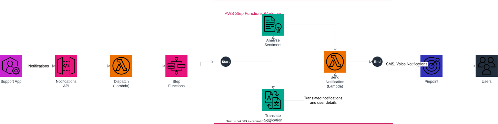

# Multi-language notification system

Build a multi-language notification system using serverless and machine learning
services. Sentiment analysis is applied to a notification before it is sent to
recipients.

A Support App submits a notification through an HTTP API, which triggers a
dispatcher Lambda that starts an AWS Step Functions workflow. The workflow runs
translation (Amazon Translate) and sentiment analysis (Amazon Comprehend) in
parallel, then merges the results in a final Lambda that sends the translated
notification through Amazon Pinpoint as an SMS or Voice message — escalating to
a voice call when the sentiment is negative.

## Architecture



| Component | AWS Service | Purpose |
| --- | --- | --- |
| Support App | — | Client submitting notification requests |
| Notifications API | Amazon API Gateway (HTTP API) | Entry point that receives notification requests |
| Dispatch (Lambda) | AWS Lambda | Starts the Step Functions execution |
| Step Functions | AWS Step Functions | Orchestrates translation, sentiment analysis, and sending |
| Analyze Sentiment | Amazon Comprehend (via Lambda) | Detects the sentiment of the notification text |
| Translate Notification | Amazon Translate (via Lambda) | Translates the notification into the recipient's language |
| Send Notification (Lambda) | AWS Lambda | Merges translation + sentiment, sends via Pinpoint |
| Pinpoint | Amazon Pinpoint | Delivers the notification as SMS (or Voice, for negative sentiment) |
| Users | — | Notification recipients |

Terraform provisions the API Gateway HTTP API, the 4 Lambda functions
(`dispatch`, `translate_notification`, `analyze_sentiment`, `send_notification`),
the Step Functions state machine (with a `Parallel` state for translation +
sentiment analysis), the Amazon Pinpoint application, and the IAM roles/policies
each component needs.

## Usage

1. Start the local Floci AWS emulator:

   ```bash
   docker compose up -d
   ```

2. Initialize and apply the Terraform scaffold:

   ```bash
   terraform init
   terraform apply
   ```

3. Inspect the outputs (API endpoint, state machine ARN, Pinpoint application
   ID, Lambda function names):

   ```bash
   terraform output
   ```

4. Submit a notification:

   ```bash
   curl -X POST "$(terraform output -raw notifications_api_endpoint)/notifications" \
     -H "Content-Type: application/json" \
     -d '{"message": "Your order has been delayed.", "recipient_phone_number": "+15555550123"}'
   ```

## Regenerating the diagram

```bash
python3 -m venv .diagram-venv
.diagram-venv/bin/pip install drawpyo
.diagram-venv/bin/python scripts/generate_diagram.py

docker run --rm -v "$PWD/docs":/data -w /data rlespinasse/drawio-export -f svg -o . --output-mode relative --remove-page-suffix .
docker run --rm -v "$PWD/docs":/data -w /data rlespinasse/drawio-export -f png -o . --output-mode relative --remove-page-suffix .
```

## Cleanup

```bash
terraform destroy
docker compose down
```
